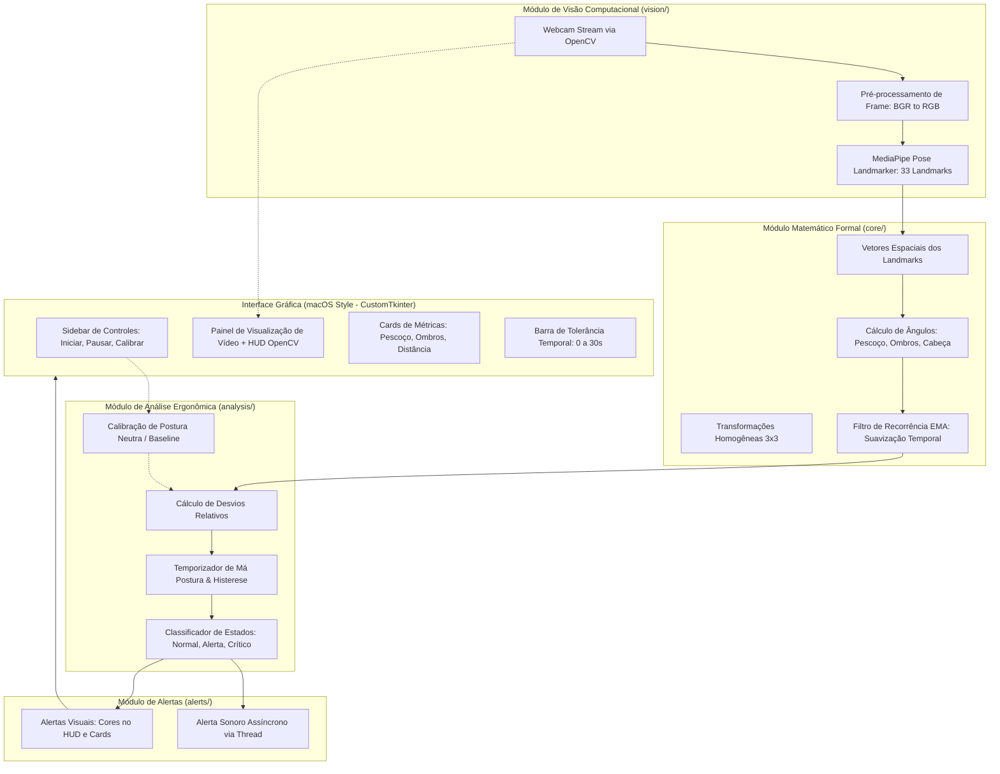

# Arquitetura do Sistema — Ergo-Friend

> **Projeto A3 — Estruturas Matemáticas e Computação Gráfica**  
> **Instituição:** Universidade Salvador (UNIFACS)  
> **Autores:** Lucas Lopes Albino, Bruno Melo, Fernando Mota  

---

## 1. Visão Geral

O **Ergo-Friend** é uma aplicação desktop desenvolvida em Python para monitoramento postural contínuo em tempo real de usuários em estações de trabalho (escritório e home office). 

O sistema utiliza a webcam padrão do computador para capturar o fluxo de vídeo, detectar pontos-chave anatômicos (*landmarks* corporais) por meio de visão computacional, processar suas relações espaciais através de formulações de **Álgebra Linear**, estabilizar medições temporais com **Relações de Recorrência** (Estruturas Matemáticas Discretas) e apresentar feedback visual e sonoro através de uma interface gráfica refinada desenvolvida em **CustomTkinter** com design e usabilidade inspirados nas diretrizes visuais do **macOS**.

---

## 2. Diagrama de Arquitetura



---

## 3. Especificação Detalhada dos Módulos

### 3.1. Módulo Matemático Formal (`core/math_model.py`)
Responsável pelas operações vetoriais e matriciais, implementado com **NumPy** e funções matemáticas puras:

1. **Representação Vetorial dos Landmarks**:
   - Cada ponto anatômico $i$ é representado como um vetor coluna bidimensional ou tridimensional:
     $$p_i = \begin{bmatrix} x_i \\ y_i \end{bmatrix} \quad \text{ou} \quad p_i = \begin{bmatrix} x_i \\ y_i \\ z_i \end{bmatrix}$$
   - *Ajuste de Convenção de Eixos de Imagem:* No plano de imagem, o eixo $y$ cresce para baixo. A vertical de referência apontando para o topo é modelada como $\vec{u}_v = \begin{bmatrix} 0 \\ -1 \end{bmatrix}$.

2. **Ângulo de Inclinação do Pescoço/Cabeça**:
   - Ponto médio dos ombros:
     $$m_s = \frac{p_{11} + p_{12}}{2}$$
   - Vetor do pescoço (dos ombros ao nariz):
     $$\vec{v}_n = p_0 - m_s$$
   - Cálculo via produto escalar e norma:
     $$\cos \theta = \frac{\vec{v}_n \cdot \vec{u}_v}{\|\vec{v}_n\| \|\vec{u}_v\|} \implies \theta = \arccos\left(\frac{\vec{v}_n \cdot \vec{u}_v}{\|\vec{v}_n\|}\right)$$
   - Ou de forma orientada com sinal via $\text{atan2}$:
     $$\theta = \text{atan2}(\vec{v}_{n,x}, -\vec{v}_{n,y})$$

3. **Alinhamento dos Ombros (Nível Horizontal)**:
   - Vetor do ombro direito ao esquerdo:
     $$\vec{v}_s = p_{12} - p_{11}$$
   - Ângulo em relação à horizontal:
     $$\phi = \text{atan2}(\vec{v}_{s,y}, \vec{v}_{s,x})$$

4. **Proximidade da Tela (Distância Normalizada)**:
   - Monitoramento da distância euclidiana inter-ombros:
     $$d_s = \|\vec{v}_s\| = \sqrt{(x_{12} - x_{11})^2 + (y_{12} - y_{11})^2}$$

5. **Transformações Geométricas Homogêneas ($3 \times 3$)**:
   - Matriz de correção de alinhamento e rotação no plano:
     $$R(\alpha) = \begin{bmatrix} \cos \alpha & -\sin \alpha & 0 \\ \sin \alpha & \cos \alpha & 0 \\ 0 & 0 & 1 \end{bmatrix}, \quad T(t_x, t_y) = \begin{bmatrix} 1 & 0 & t_x \\ 0 & 1 & t_y \\ 0 & 0 & 1 \end{bmatrix}$$

6. **Modelagem por Relação de Recorrência (Suavização EMA)**:
   - Reduz oscilações espúrias (*jitter*) entre frames consecutivos:
     $$\theta_n = \alpha \cdot \theta_n^{\text{med}} + (1 - \alpha) \cdot \theta_{n-1}, \quad 0 < \alpha \le 1$$
   - Caso base: $\theta_0 = \theta_0^{\text{med}}$.
   - Demonstração por indução da soma dos pesos convergente a 1.

---

### 3.2. Módulo de Visão Computacional (`vision/pose_detector.py`)
- Gerenciamento de captura de vídeo através de `cv2.VideoCapture`.
- Detecção de pontos de pose utilizando a API do **MediaPipe Tasks / PoseLandmarker**.
- Extração de landmarks de interesse:
  - Nariz: índice `0`
  - Orelhas: esquerda `7`, direita `8`
  - Ombros: esquerdo `11`, direito `12`
  - Quadris (opcional): esquerdo `23`, direito `24`
- Conversão de coordenadas normalizadas $[0, 1]$ para coordenadas de pixel da imagem.

---

### 3.3. Módulo de Análise Ergonômica (`analysis/posture_analyzer.py`)
- **Calibração de Postura Neutra**:
  - Permite que o usuário defina sua postura correta de referência através de uma média de amostras de 3 segundos (acionada via botão na interface ou tecla `C`).
  - Armazena a linha de base: $\theta_{\text{ref}}$, $\phi_{\text{ref}}$, $d_{s,\text{ref}}$.
- **Detecção de Desvios**:
  - Desvio de inclinação de pescoço: $|\theta_n - \theta_{\text{ref}}| > \delta_\theta$ (ex: $> 15^\circ$).
  - Assimetria de ombros: $|\phi_n - \phi_{\text{ref}}| > \delta_\phi$ (ex: $> 8^\circ$).
  - Proximidade da tela: $d_{s,n} / d_{s,\text{ref}} > 1.25$ (usuário projetado muito próximo ao monitor).
- **Controle de Tempo e Histerese**:
  - Acúmulo de tempo contínuo de má postura ($T_{\text{inadequado}}$).
  - Limiar de tolerância de 30 segundos configurável.
  - Esvaziamento gradual do temporizador quando o usuário corrige a postura (evitando falsos resets ao mudar brevemente de posição).

---

### 3.4. Módulo de Interface com Estilo macOS (`gui/app_window.py`)
Construído com **CustomTkinter** seguindo as diretrizes de componentes e controles visuais do ecossistema macOS (conforme referência de painéis de configuração / inspetores do macOS):
- **Estética de Controles e Componentes**:
  - Janela padrão do sistema operacional (sem necessidade de emular botões de minimizar/fechar no canto superior).
  - **Botões com Estilo macOS**: botões com cantos arredondados suaves (`corner_radius=6` a `8`), bordas sutis, preenchimento neutro elegante para ações secundárias e destaque em azul macOS (`#007AFF`) para ações primárias.
  - **Controles de Formulário e Seleção**: caixas de seleção (checkboxes) e menus suspensos com visual limpo, bordas sutis e fundo translúcido/cinza claro característicos.
  - **Paleta de Cores macOS**:
    - Fundo de painel e cards: `#ECECEC` / `#F5F5F7` (modo claro) ou `#1E1E1E` / `#2A2A2A` (modo escuro).
    - Cor de destaque (Accent): `#007AFF` (Azul macOS).
    - Status de atenção/erro: Âmbar `#FF9500` e Vermelho `#FF3B30`.
    - Divisores suaves e tipografia nítida (SF Pro / Segoe UI / Helvetica).
- **Layout em Duas Seções**:
  1. **Barra Lateral (Sidebar / Control Bar)**:
     - Logo e status da aplicação.
     - Botão primário com estilo macOS ("Iniciar Monitoramento" / "Pausar").
     - Botão de calibração ("Calibrar Postura").
     - Sliders de sensibilidade e seletor de limiar de tempo (15s, 30s, 60s).
     - Switch de som (ativar/desativar bip).
  2. **Painel Central**:
     - Visualização do Feed da Webcam integrado (com esqueleto estilizado e cores dinâmicas).
     - Grade de "Cards" com métricas ergonômicas ao vivo (Ângulo do Pescoço, Nível dos Ombros, Distância).
     - Barra de progresso de tolerância com animação suave de enchimento até os 30s.

---

### 3.5. Módulo de Alertas (`alerts/audio_alert.py`)
- Disparo de avisos sonoros de baixa latência em thread desacoplada (`threading.Thread`), garantindo que a renderização da interface e o processamento de vídeo permaneçam estáveis em 30+ FPS sem engasgos.
- Alerta visual sincronizado em nível de interface e HUD do vídeo.

---

## 4. Estrutura de Diretórios do Projeto

```
ergo-friend/
│
├── ARQUITETURA.md             # Este documento
├── RelatorioA3.pdf            # Relatório teórico original da Entrega 1
├── requirements.txt           # Dependências do projeto
│
├── core/                      # Módulo matemático formal (Álgebra Linear & Recorrência)
│   ├── __init__.py
│   └── math_model.py
│
├── vision/                    # Módulo de captura e detecção de pose
│   ├── __init__.py
│   └── pose_detector.py
│
├── analysis/                  # Regras ergonômicas, calibração e histerese temporal
│   ├── __init__.py
│   └── posture_analyzer.py
│
├── alerts/                    # Sistema de notificações sonoras e visuais
│   ├── __init__.py
│   └── audio_alert.py
│
├── gui/                       # Interface gráfica macOS-like em CustomTkinter
│   ├── __init__.py
│   ├── app_window.py
│   └── components/
│       ├── __init__.py
│       ├── metric_card.py
│       └── video_panel.py
│
├── tests/                     # Testes unitários para validar a matemática e regras
│   ├── __init__.py
│   └── test_math_model.py
│
└── main.py                    # Ponto de entrada da aplicação
```

---

## 5. Roteiro de Entregas Incrementais

Conforme a estratégia de melhorias incrementais solicitada:

1. **Parte 1 (Atual):**
   - Criação da documentação arquitetural (`ARQUITETURA.md`).
   - Implementação do núcleo matemático formal (`core/math_model.py`) e testes unitários (`tests/test_math_model.py`) comprovando a precisão da álgebra linear e das relações de recorrência.
   - Commit incremental.
2. **Parte 2:**
   - Integração da captura de vídeo e detecção de landmarks (`vision/pose_detector.py`) e regras ergonômicas com calibração e histerese (`analysis/posture_analyzer.py`).
   - Commit incremental.
3. **Parte 3:**
   - Desenvolvimento da interface visual em CustomTkinter no estilo macOS (`gui/`) e alertas sonoros assíncronos (`alerts/`).
   - Teste ponta a ponta e entrega final.

